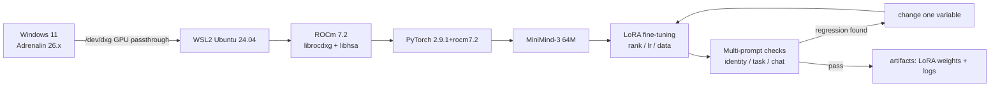

# minimind-on-rocm


Run [MiniMind](https://github.com/jingyaogong/minimind) (64M tiny LLM) on an **AMD consumer GPU**
(Radeon RX 7800 XT, gfx1101, 16 GB) under **Windows 11 + WSL2 + ROCm 7.2** — inference, LoRA fine-tuning,
and a small experiment framework.

> Upstream: jingyaogong/minimind (Apache-2.0). This repository does **not** contain upstream code,
> model weights, or pretraining/RLHF pipelines. Scope is stated explicitly below.

## Architecture



## Why

AMD cards are cheap per GB of VRAM (16 GB fits a 7B-Q4 or 14B-Q4 model), which makes them attractive
for personal LLM experiments. But ROCm documentation for Windows/WSL is scattered, and upstream MiniMind
targets CUDA + multi-GPU workstations only. This repo records a working path end-to-end.

## Scope and contributions

| Item | Upstream | This repo |
|---|---|---|
| Model architecture / training code / datasets | Author | Used as-is (plus one parameterization patch upstreamed as PR #894) |
| Pretraining / RLHF / distillation / tool-call | Yes | **Not covered** |
| Inference, small-scale full SFT | Yes (CUDA) | Verified on ROCm |
| WSL2 + ROCm 7.2 + PyTorch ROCm wheels | No | **Added**: `docs/SETUP_WSL_ROCM.md` |
| Crash root-cause (HSA allocator exhaustion in WSL) | No | **Added**: `docs/TROUBLESHOOTING.md` |
| Experiment framework + qualitative checks | No | **Added**: `scripts/`, `docs/EXPERIMENTS.md` |
| Chinese identity dataset | English only | **Added**: `data/lora_identity_zh.jsonl` |

## Quick start

```bash
bash scripts/setup_wsl_rocm.sh                       # ROCm 7.2 + PyTorch ROCm wheels
rocminfo | grep -E "gfx|Marketing"                   # expect gfx1101
python -c "import torch; print(torch.cuda.is_available())"

git clone --depth 1 https://github.com/jingyaogong/minimind
modelscope download --model gongjy/minimind-3 --local_dir ./minimind/minimind-3

python scripts/make_identity_zh.py --out minimind/dataset/lora_identity_zh.jsonl
cd minimind/trainer && python train_lora.py --lora_rank 8 --lora_name zh_r8 \
  --from_weight full_sft_sub --data_path ../dataset/lora_identity_zh.jsonl \
  --epochs 3 --batch_size 4 --max_seq_len 340 --learning_rate 1e-4 --num_workers 0
```

## Measured on RX 7800 XT (16 GB, ROCm 7.2)

| Workload | Result |
|---|---|
| Qwen2.5-7B-Instruct Q4_K_M (LM Studio + ROCm runtime) | **95.9 tok/s**, 5.6 GB VRAM |
| MiniMind-3 64M inference (transformers, fp16) | 200–230 tok/s |
| fp16 matmul 4096³ | **45.7 TFLOPS** (61% of ~74 TFLOPS peak) |
| LoRA training (64M, bs=4, seq=340) | ~1.5 s/step |

## Findings

1. Training loss and generation quality **diverge**: rank 32 reached the lowest training loss
   while its output collapsed into an English-fragment loop.
2. The collapse requires *both* narrow data distribution and large rank; with mixed Chinese data
   the same configuration behaves normally.
3. The real work in small-model fine-tuning is building checks that expose
   "metric ≠ objective" — not tuning hyperparameters.

## Layout

```
docs/SETUP_WSL_ROCM.md     environment setup with version matrix and acceptance commands
docs/TROUBLESHOOTING.md    8 ROCm/WSL-specific issues: symptom, root cause, fix
docs/EXPERIMENTS.md        full experiment log (rank / lr / data / epochs sweeps)
docs/PITFALLS.md           10 lessons on fine-tuning small models
scripts/                   setup, dataset generation, experiment logging, evaluation
data/                      Chinese identity dataset + data card
benchmarks/                raw benchmark data from this machine
```

## License

Apache-2.0. Upstream MiniMind © Jingyao Gong, Apache-2.0. Model weights are published by the
original author and are not redistributed here.