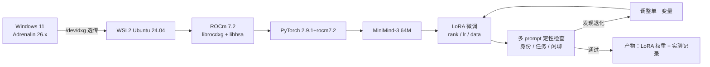

# minimind-on-rocm


在 **AMD 消费级显卡**（RX 7800 XT / gfx1101，16 GB）+ **Windows 11 + WSL2 + ROCm 7.2** 上，
跑通 [MiniMind](https://github.com/jingyaogong/minimind) 的推理与微调链路，并提供：

- 一键环境搭建脚本与踩坑记录（ROCm/WSL 特有的 8 个坑）
- 7800 XT 上的实测基准（推理 tok/s、fp16 TFLOPS、LoRA 训练吞吐）
- 可复用的实验框架（单变量记录、对比出表、多 prompt 定性检查）
- 中文自我认知数据集（392 条，含通用对话混合）与生成脚本

> 上游项目：jingyaogong/minimind（Apache-2.0）。**本仓库不包含上游代码，也不声称模型是本人训练**，
> 详见下方「范围与贡献」。

## 架构与流程



## 为什么做这个

AMD 显卡显存大、价格低（16 GB 能装下 7B-Q4 或 14B-Q4），是个人做小模型实验的性价比选择。
但 ROCm 在 Windows/WSL 上的资料零散，上游项目只覆盖 CUDA + 多卡 3090。
本仓库把「从零到能训练」这条路走通并记录下来，目标是让别人少踩一遍。

## 范围与贡献

| 项目 | 上游 | 本仓库 |
|---|---|---|
| 模型结构 / 训练代码 / 数据 | 原作者 | 直接使用，未修改（除一处参数化补丁） |
| 预训练 / RLHF / 蒸馏 / Tool Call | 有 | **未覆盖** |
| 推理、full SFT（小规模） | 有（CUDA） | 在 ROCm 上验证 |
| 环境适配（WSL2 + ROCm 7.2 + PyTorch ROCm 轮子） | 无 | **新增**：`docs/SETUP_WSL_ROCM.md` |
| 崩溃归因（WSL 下 HSA 内存池泄漏） | 无 | **新增**：`docs/TROUBLESHOOTING.md` |
| 实验框架与定性检查 | 无 | **新增**：`scripts/`、`docs/EXPERIMENTS.md` |
| 中文身份数据集 | 有英文版 | **新增**：`data/lora_identity_zh.jsonl` |

## 快速开始

```bash
# 1. 环境（Windows 侧先装好 WSL2 + Ubuntu 24.04，驱动 >= Adrenalin 26.x）
bash scripts/setup_wsl_rocm.sh

# 2. 验证
rocminfo | grep -E "gfx|Marketing"
python -c "import torch; print(torch.cuda.is_available(), torch.cuda.get_device_name(0))"

# 3. 拉取上游并下载权重
git clone --depth 1 https://github.com/jingyaogong/minimind
modelscope download --model gongjy/minimind-3 --local_dir ./minimind/minimind-3

# 4. 生成中文身份数据并训练 LoRA
python scripts/make_identity_zh.py --out minimind/dataset/lora_identity_zh.jsonl
cd minimind/trainer && python train_lora.py --lora_rank 8 --lora_name zh_r8 \
  --from_weight full_sft_sub --data_path ../dataset/lora_identity_zh.jsonl \
  --epochs 3 --batch_size 4 --max_seq_len 340 --learning_rate 1e-4 --num_workers 0
```

## 实测基准（RX 7800 XT 16 GB, ROCm 7.2）

| 场景 | 结果 |
|---|---|
| 7B Q4_K_M 推理（LM Studio + ROCm 运行时） | **95.9 tok/s**，显存 5.6 GB |
| 64M 模型推理（transformers, fp16） | 200–230 tok/s |
| fp16 4096³ 矩阵乘 | **45.7 TFLOPS**（理论峰值 74 的 61%） |
| LoRA 训练（64M, bs4, seq340） | 约 1.5 s/step |

## 目录结构

```
docs/SETUP_WSL_ROCM.md     环境搭建（含版本对照与验收命令）
docs/TROUBLESHOOTING.md    8 个 ROCm/WSL 特有问题的现象、根因与处理
docs/EXPERIMENTS.md        完整实验记录（rank / lr / 数据 / 步数四组对照）
docs/PITFALLS.md           10 条小模型微调方法学教训
scripts/                   环境安装、数据生成、实验记录、结果对比、批量评测
data/                      中文身份数据集与数据卡
benchmarks/                7800 XT 实测原始数据
```

## 三条结论（详见 docs/EXPERIMENTS.md）

1. 训练 loss 与生成质量会**背离**：rank 32 的 loss 最低，输出却崩坏成英文碎片循环。
2. 崩坏需要「窄分布数据 + 大容量」两个条件同时成立；换成中文混合数据后同样配置恢复正常。
3. 小模型微调的主要工作不是调参，而是建立能识破「指标与目标不一致」的检查手段。

## 许可与致谢

- 本仓库代码与文档：Apache-2.0
- 上游 MiniMind：© Jingyao Gong，Apache-2.0
- 模型权重：由原作者发布，本仓库不包含权重文件
